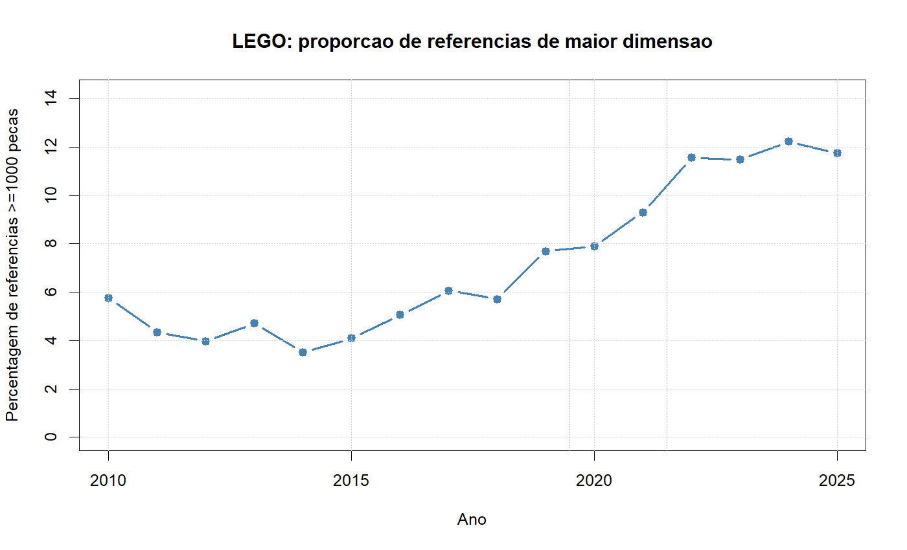
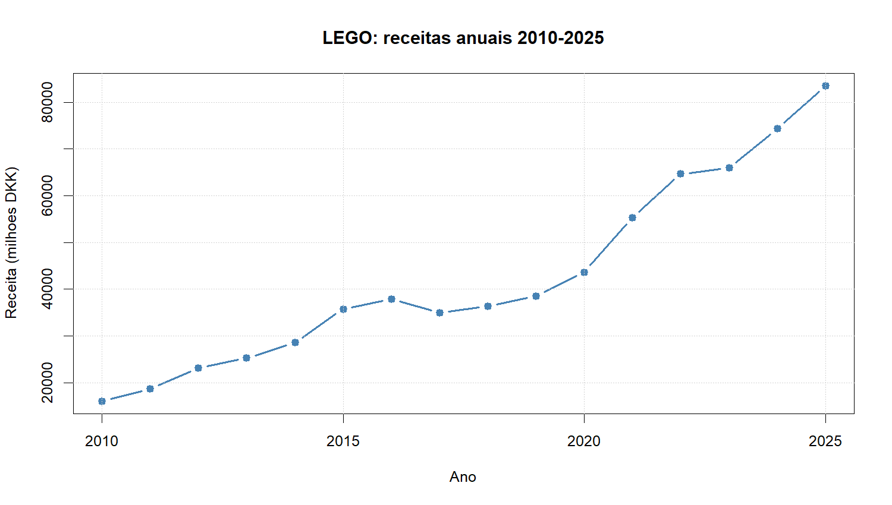
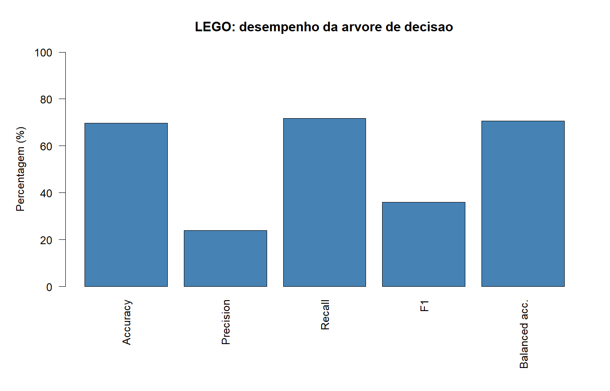
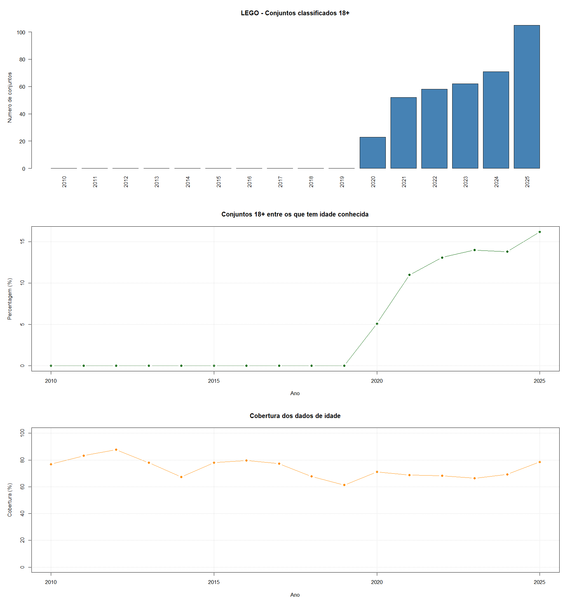

# LEGO 2010–2025 | Portfolio Growth, Product Complexity & the 18+ Segment

**Data Analytics in R — CESAE Digital / PRO_MOV**  
**Author:** Valter Teixeira  
**Period:** 2010–2025  
**Keywords:** Data Cleaning · EDA · Business Intelligence · Machine Learning · Decision Tree · Spearman Correlation

> This is an independent educational analysis. LEGO® is a trademark of the LEGO Group; this project is not sponsored by or affiliated with the LEGO Group, Rebrickable or Brickset.

## Visual highlights

### Catalogue complexity: more large sets over time

### Revenue evolution, in millions of Danish kroner

### Model performance: predicting 1,000+ piece sets

### The growth of LEGO's explicit 18+ label, 2020–2025

The 18+ label was introduced around 2020. The graph does **not** imply that LEGO had no adult-oriented products before that year. Classifications are based on the `brickset` R package and have incomplete coverage.

## Business questions

- **BI 1** — Has the LEGO catalogue shifted towards larger sets?
- **BI 2** — How did the LEGO Group's financial performance evolve?
- **BI 3** — Which product families increased their share of sets with at least 1,000 pieces?
- **BA 1** — Can a decision tree classify sets as small or large using release year and family?
- **BA 2** — Are changes in the share of large sets associated with year-over-year revenue growth?
- **Extension** — How has the catalogue's 18+ age classification evolved since 2020, and how is it associated with revenue?

## Selected findings

| Finding | Verified project output |
|---|---:|
| Raw catalogue records (2010–2025) | 17,313 |
| Filtered analytical set references | 9,410 |
| Median pieces, 2010–2019 | 92 |
| Median pieces, 2022–2025 | 181 |
| Share of ≥1,000-piece sets, 2010–2019 | 5.13% |
| Share of ≥1,000-piece sets, 2022–2025 | 11.77% |
| Revenue 2010 / 2025 | DKK 16,014m / DKK 83,530m |
| Decision-tree recall (test 2023–2025) | 71.70% |
| Decision-tree precision (test 2023–2025) | 24.02% |
| Age-classification coverage | 72.92% |
| Sets classified 18+ (among matching records) | 371 |

**Interpretation:** The catalogue shows a greater share of larger sets, and the company has grown financially. This dataset does *not* demonstrate that larger sets or 18+ products caused the revenue growth. It contains catalogue references rather than sales quantities or transaction records.

## Reproducibility

1. Install a compatible version of **R** and **RStudio**.
2. Open `Projeto_LEGO_2010_2025.Rproj` (project root).
3. Run `source("INSTALAR_DEPENDENCIAS.R")` once. Dependencies: `rpart`, `rpart.plot`, `brickset` (the reported analyses used `brickset 2026.0.0`).
4. Obtain the latest `sets.csv.gz` and `themes.csv.gz` from [Rebrickable Downloads](https://rebrickable.com/downloads/) and save both in `dados/originais/`. The helper `source("scripts/00_obter_dados_rebrickable.R")` can download them if missing. The current Rebrickable catalogue **will not necessarily produce the historical counts shown here**.
5. Run `source("00_EXECUTAR_TUDO.R")` from the project root.
6. Review the generated tables in `dados/processados/` and figures in `resultados/graficos/`.

### Dataset snapshot for the published results

The exact counts above were calculated on a specific local snapshot of Rebrickable, identified by MD5:

- `sets.csv.gz`: `f28b85fb54583272aabb0ca56cf81162`
- `themes.csv.gz`: `1d7f14a5ae1568f6ea2360ea141e343d`
- `lego_financas_2010_2025_conferencia.csv`: `183ab042abc9f4ef0c5848b361e2c60e`

The source catalogues and the LEGO annual-report PDFs are **not included in the public ZIP** to avoid distributing third-party datasets and documents without confirming redistribution rights. The included small tables and figures document the original analysis; for exact end-to-end reproduction the same original snapshots are needed. Package version changes may also alter the Brickset age-matching results.

### What the scripts do

| File | Role |
|---|---|
| `scripts/01_preparacao_conjuntos.R` | Import and clean the Rebrickable catalogue; resolve themes/families. |
| `scripts/02_tamanhos_periodos.R` | Descriptive statistics by year and period. |
| `scripts/03_familias.R` | Compare themes and large-set shares. |
| `scripts/04_financas_BI.R` | Financial indicators and charts. |
| `scripts/05_arvore_decisao_BA1.R` | Train/validate a classification tree with a temporal split. |
| `scripts/06_correlacao_BA2.R` | Spearman test on annual changes in catalogue composition versus revenue growth. |
| `scripts/08_analise_segmento_adulto.R` | Candidate product lines and Brickset age matching. |
| `scripts/09_relacao_adultos_receitas.R` | Spearman correlations for age-classified share and revenue. |
| `scripts/07_verificacoes_finais.R` | End-of-pipeline integrity checks. |
| `00_EXECUTAR_TUDO.R` | Run all nine analytical scripts in order. |

## Methodology and limitations

- Inclusion: catalogue years 2010–2025, positive `num_parts`, excluding the root families `Gear`, `Books` and `Collectible Minifigures`; the special record `BIGBOX-1` was also removed. These choices constrain the population of interest.
- A **large set** means ≥1,000 pieces. The decision-tree target is generated from that threshold, but **piece count is not a predictor** to avoid data leakage.
- Tree validation: train 2010–2019, validate 2020–2022, retrain 2010–2022, exploratory test 2023–2025. Test results should not be described as fully untouched because the hold-out had already been consulted during development.
- Age coverage: 6,862 / 9,410 references (72.92%). Classification labelled `18+` has historical meaning and should not be projected backwards as proof there were no adult-oriented products before 2020.
- Correlation of large-set-share annual change versus revenue growth: Spearman rho = -0.1179, p = 0.6757 (n=15).
- For 2020–2025, the Spearman correlation between age-labelled 18+ share and revenue was rho = 0.9429, exact p = 0.01667 (n=6); for year-on-year changes rho = 0.5, exact p = 0.45 (n=5). Trend confounding and sparse data prevent causal inference.
- The financial series is in **millions of DKK**, not euros. Financial statements changed in presentation and treatment across years, including the IFRS 16 lease accounting change in 2019.

## Data provenance / financial audit

- [Rebrickable — Downloads](https://rebrickable.com/downloads/)
- [R package `brickset` (CRAN)](https://cran.r-project.org/package=brickset)
- [LEGO Group reports](https://www.lego.com/en-us/aboutus/lego-group/policies-and-reporting/reports)
- [2011 annual report](https://www.lego.com/cdn/cs/aboutus/assets/bltfc5240b2ffa6738f/Annual_Report_2011_ENG.pdf)
- [2016 annual report](https://www.lego.com/cdn/cs/aboutus/assets/blt0b5f75205fb17080/Annual_Report_2016_ENG.pdf)
- [2021 annual report](https://www.lego.com/cdn/cs/aboutus/assets/blt248041929be3b572/Annual_Report_2021_ENG.pdf)
- [2025 annual report](https://www.lego.com/cdn/cs/aboutus/assets/blte543dd46714c9226/The_LEGO_Group_2025_Annual_Report.pdf)

The financial-reference CSV contains 16 years × 3 indicators. All **48 distinct values** were independently checked against four published Financial Highlights tables. The mapping and page numbers are in `auditoria_financeira_48_valores.csv`. This verification checks the dataset used in the analysis; it is not a formal financial audit.

## Figures

The `resultados/graficos` folder contains portfolio, family, financial, ML and age-classification charts produced by the original R scripts. Output charts and small aggregated tables are included for browsing without running R.

## Academic scope

Developed for an individual R practical assignment requiring dataset preparation, exploration, ≥2 BI questions, ≥2 BA questions (including a machine-learning algorithm taught in class), and a critical reflection. Decision-tree classification was covered in the CESAE Digital R syllabus; the project implements it using the `rpart` R package.

## How to read the project

- [Methodology and data-quality decisions](docs/METHODOLOGY.md)
- [Financial audit and original source references](docs/FINANCIAL_AUDIT.md)
- [Reproducibility and dataset caveats](docs/REPRODUCIBILITY.md)

## License and use

This repository shares original analysis code and aggregate research outputs for educational and portfolio review. Third-party source catalogues and published LEGO annual-report PDFs are not redistributed here. No open-source license has been selected for this repository; contact the author before reusing the original code beyond the permissions granted by applicable law.
